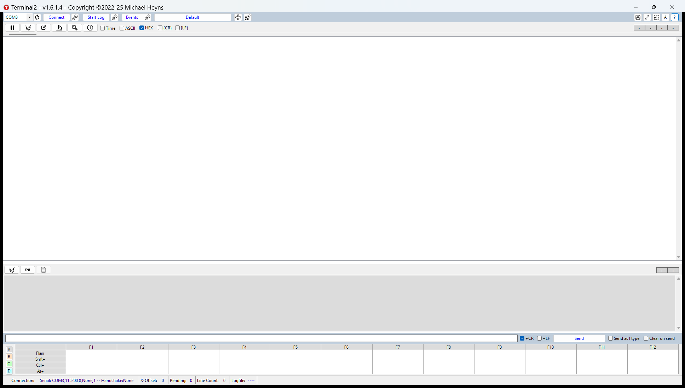
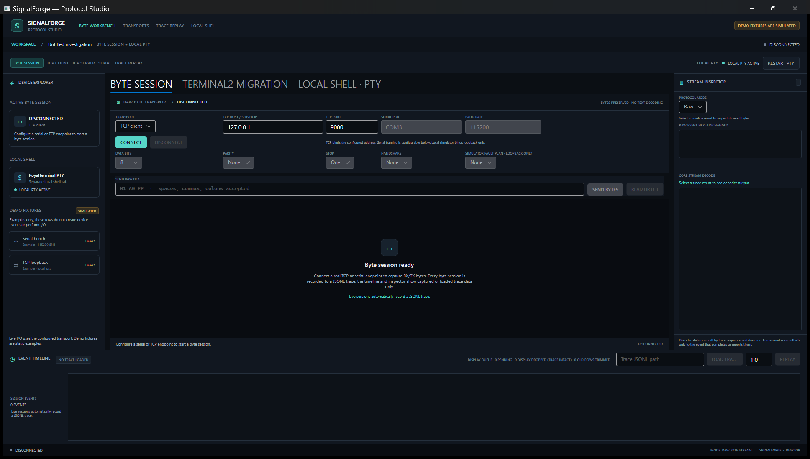
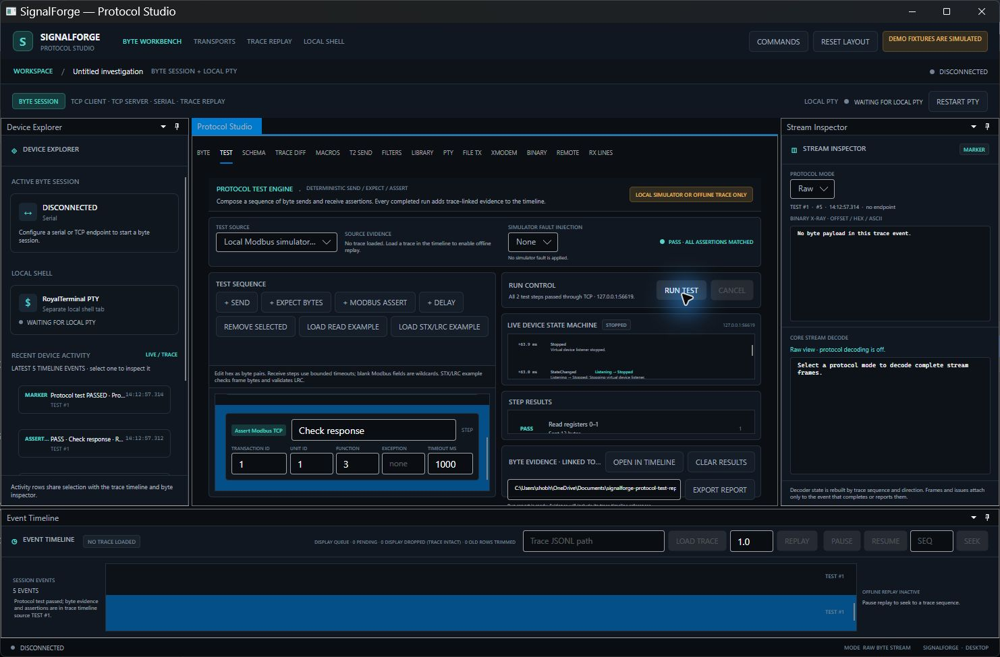

# SIGNALFORGE

[](https://github.com/shobhit1kapoor/signalforge-avalonia-port-challenge/actions/workflows/ci.yml)

SIGNALFORGE is a cross-platform engineering terminal and protocol-forensics workstation built with .NET 10 and Avalonia. It is a GPL-3.0-or-later modernization of [Terminal2](https://github.com/michael-heyns/Terminal2), with additional transport, inspection, simulation, trace, and test workflows.

## Project status

This project is under active development. The source audit, migration map, architecture, and initial parity inventory are in `docs/`. Features are marked honestly as implemented, partial, or not yet implemented in [PARITY.md](docs/PARITY.md).

## Requirements

- .NET SDK 10.0.302 (pinned by `global.json`)
- Windows, macOS, or Linux for the desktop app

## Build and run

```powershell
dotnet restore SignalForge.slnx --locked-mode
dotnet build SignalForge.slnx -c Release --no-restore
dotnet test tests/SignalForge.Core.Tests/SignalForge.Core.Tests.csproj -c Release --no-restore --blame-hang-timeout 3m --filter "FullyQualifiedName!~SignalForge.Core.Tests.Desktop.Terminal2SendWorkflowViewModelTests"
dotnet test tests/SignalForge.Core.Tests/SignalForge.Core.Tests.csproj -c Release --no-restore --blame-hang-timeout 3m --filter "FullyQualifiedName~SignalForge.Core.Tests.Desktop.Terminal2SendWorkflowViewModelTests"
dotnet run --project src/SignalForge.Desktop
```

The desktop opens an explicitly labeled local RoyalTerminal PTY when its shell tab is selected. The Windows PTY was manually checked with a PowerShell command and visible output. It does not open a serial port or connect to a remote endpoint on startup. The loopback-only Modbus TCP simulator is opt-in from the transport selector.

The workspace includes a byte-session inspector with binary search, safe replacement preview and Base64 tools; a Terminal2-compatible text-file sender and serial XMODEM sender; pause/seek trace replay; aligned trace comparison; a local profile library; a JSON user-schema editor/decoder; and a protocol test runner with configurable loopback fault injection for pass/fail checks. Test reports are versioned JSON documents with rerunnable scenario settings, exact byte evidence and links back to the timeline; retained pass/fail examples are in [`docs/evidence`](docs/evidence/). Test runs are restricted to the local simulator and explicitly loaded offline traces. Dock.Avalonia hosts a rearrangeable Device Explorer, Protocol Studio, Stream Inspector and Event Timeline in nested splits; the Explorer shows the active transport and local PTY plus five recent timeline events, and its selection follows the trace inspector. Workspace state and the selected feature tab save locally. The current Windows workspace and interactive local PTY were manually checked. Dock **Float** opens Protocol Studio in a separate native window, and **RESET LAYOUT** closes it and restores the default workspace; dragging the pane back and restoring a custom layout after restart remain unverified. The command palette provides searchable actions. A separate remote terminal tab supports SSH password sessions and Telnet through RoyalTerminal; remote terminal text is not part of the engineering byte-session trace.

## Platform packages

Download the latest [Windows x64, Linux x64, and macOS ARM64 builds](https://github.com/shobhit1kapoor/signalforge-avalonia-port-challenge/releases/latest). Each tagged release includes `SignalForge-windows-x64.zip`, `SignalForge-linux-x64.tar.gz`, `SignalForge-macos-arm64.tar.gz`, and a `SHA256SUMS.txt` manifest. Extract the package and launch `SignalForge.Desktop.exe` on Windows or `./SignalForge.Desktop` on Linux/macOS. The macOS binary is unsigned and is not notarized. The release workflow builds and launches each package on its corresponding GitHub-hosted platform runner before publishing it.

The local 261-test suite passes in the CI split on Windows and Ubuntu 26.04 under WSL2: 260 tests, then the dispatcher workflow test in isolation. The combined Windows run exceeded the 3-minute hang limit at that workflow in an earlier combined run; the combined Linux run reports an Avalonia dispatcher thread-ownership exception. CI uses the passing split with a 3-minute VSTest hang diagnostic. The first [hosted GitHub Actions run](https://github.com/shobhit1kapoor/signalforge-avalonia-port-challenge/actions/runs/40028123099) passed all three platform jobs, including native build, launch smoke check, and package creation. Windows and Linux packages also passed local 12-second startup checks; local Linux ran under WSL2/Xvfb. Full commands and the exact scope are in the [verification record](docs/evidence/verification-2026-10-23.md).

## Migration write-up

Terminal2 v1.6.1.4 was a Windows Forms application on .NET Framework 4.8. SIGNALFORGE replaces the WinForms shell with Avalonia on .NET 10 and replaces Terminal2's shared communication layer with per-session serial and TCP transports. The port keeps the byte stream separate from the interactive shell, then adds trace inspection and repeatable protocol tests around that core workflow.

Profile import/export, the `$HH`/`$$` send notation, the STX/ETX/LRC codec, and first-match filter rules could be carried over as explicit portable services and checked against source-derived behavior. The desktop, transport lifetime, cancellation, and logging needed redesign; treating TCP receive chunks as complete messages would have broken line and LRC handling, so incoming data is reassembled before validation. The port preserves the most useful profile, macro, filter, and send workflows, while command-history shortcuts, RTF/text import/export, and some legacy settings remain incomplete. We did not track development hours, so an hour estimate would be invented; the migration map and parity report document the actual scope and remaining work.

## Migration summary

SIGNALFORGE ports Terminal2 v1.6.1.4 from Windows Forms on .NET Framework 4.8 to Avalonia 12 on .NET 10. The upstream source is pinned at `d3adbd301963b729885cc41fb75b3a80bcdf5472` and remains separately attributed under GPL-3.0-or-later. We replaced the original static communication layer with per-session serial/TCP transports and exact-byte traces, then kept the VT shell separate from protocol traffic.

The migration tab imports and exports Terminal2 `.profile` data, stages supported connection settings for the next connection, parses `$HH` and `$$` send text using imported CR/LF settings, and runs selected macro slots through a cancellable compatibility engine. Startup creates the legacy `Default` profile when needed and restores the active profile marker. The optional profile-driven send-as-you-type mode buffers incomplete `$HH`/`$$` escapes, pauses during macros, and reports that transmitted bytes cannot be retracted; the STX/ETX button sends the exact framed bytes through the trace-backed session. The RX line-history surface reassembles arbitrary receive chunks across CR, LF and split CRLF boundaries, shows the partial line, searches complete lines, supports stop-at and freeze/resume while trace capture continues, applies the profile's first-match filters, and recalls selected completed lines without sending them. A matching live completed line can also run the exact-title macro configured on its first matching filter; queued triggers execute serially, have a 64-trigger bound, and never fire when browsing offline history or traces. Exact payload bytes remain in the trace and are available in the selected line's hex. The profile library lists, searches, loads, saves, copies, renames and deletes compatible profiles, and can create a blank profile with Terminal2 defaults. Its editor covers fields supported by the existing serializer; `Active` and `ShowLogControl` have no serializer keys, while macro, filter and title editing remains in their dedicated editors. The text-file sender preserves nonempty-line splitting, optional CR/LF suffixes, inter-line delay, pause and cancellation, with each line sent through the byte session and recorded in its trace. The serial-only XMODEM sender uses 128-byte CRC-16/XMODEM blocks, bounded NAK retries, acknowledgement timeouts, cancellation, progress and the Terminal2 zero-byte-file behavior; both blocks and responses remain in the byte-session trace. The macro editor exposes all 192 slots across four banks, edits command text, timing, repeats and CR/LF options, and selects which bank F1–F12 hotkeys target. Within the selected bank, Shift/Ctrl/Alt choose hotkey rows two through four; the first row uses unmodified F1–F12. The byte-session inspector also decodes Terminal2 STX/ETX/LRC framing. New Modbus, loopback protocol simulators, trace comparison, user schemas and protocol testing are SIGNALFORGE additions, not Terminal2 parity claims. The test tab can exercise a Terminal2 STX/ETX/LRC echo simulator and detect a deliberately corrupted response LRC.

The workspace toolbar and imported `#STARTLOG` / `#STOPLOG` directives control a separate timestamped TX/RX hex log using the active profile's directory, prefix and maximum size. Automatic session JSONL capture continues independently.

Terminal2 command-history navigation, text/RTF import/export, and settings without serializer keys remain incomplete or absent. Hex search, replacement preview and Base64 tools operate on selected trace events only; replacement is a copy preview and does not mutate captures. The remote terminal supports SSH password authentication with OpenSSH `known_hosts` checks or an optional SHA-256 host-key fingerprint; credentials are kept in process memory for the session and are not persisted. SSH agent/key authentication and remote-session trace capture are not implemented. Telnet is available with an explicit unencrypted-transport notice. Physical serial hardware remains unverified. See [the parity inventory](docs/PARITY.md) and [the source-level migration map](docs/MIGRATION.md) for exact limits.

## Before and after

| Terminal2 v1.6.1.4 | SIGNALFORGE |
|---|---|
|  |  |

## Live protocol activity



Recent Device Explorer rows come from the same trace event collection as the Event Timeline; selecting a row selects that event for inspection.

The [release page](https://github.com/shobhit1kapoor/signalforge-avalonia-port-challenge/releases) keeps the downloadable packages and their checksums together. Local archives used for verification are ignored under `artifacts/` and are not required to build from source.

## Codec benchmarks

Run `dotnet run --project benchmarks/SignalForge.Benchmarks -c Release -- 250000` to measure Modbus TCP decoding and Modbus RTU CRC. Results and limits are in the [verification record](docs/evidence/verification-2026-10-23.md); these are in-process codec microbenchmarks, not end-to-end application performance results.

## Migration evidence

- [Source audit and migration map](docs/MIGRATION.md)
- [Architecture and transport contracts](docs/ARCHITECTURE.md)
- [Feature parity inventory](docs/PARITY.md)
- [Runtime demo, screenshots, and repeatable simulator steps](docs/DEMO.md)
- [Avalonia Port Challenge rules and entry checklist](docs/CHALLENGE.md)
- [Third-party notices](docs/LICENSES.md)

## License

SIGNALFORGE is distributed under GPL-3.0-or-later. See [LICENSE](LICENSE) and [LICENSES.md](docs/LICENSES.md) for upstream attribution and dependency notices.
