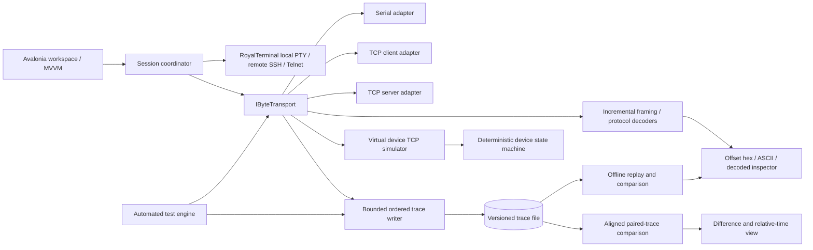

# SIGNALFORGE architecture

## Goals and boundaries

SIGNALFORGE has two terminal domains that share a workspace but never confuse their data:

1. **VT terminal sessions** use RoyalTerminal for local PTY and remote SSH/Telnet surfaces. This is the mature terminal-emulation component; its reuse is identified in the UI and dependency notices. The SSH/Telnet terminal is distinct from the engineering byte-session transports and does not record remote VT traffic into byte traces.
2. **Engineering byte sessions** use SIGNALFORGE-owned serial, TCP client/server, and simulator transports. Core provides trace-backed byte sessions; the desktop exposes connection controls, timeline, stream inspection, replay, and selected Terminal2 migration workflows. A VT emulator is not the source of truth for arbitrary binary protocols.

The Terminal2 profile and macro-file formats, text byte escapes, STX/ETX-LRC framing, first-match filters, text-file transfer, and XMODEM sender have first-party compatibility modules. The desktop migration tab imports and exports profiles, stages supported connection settings for the next connection, sends parsed `$HH`/`$$` text using imported CR/LF settings, and runs selected imported macro slots. Startup creates the legacy `Default` profile if needed and restores selection from the Terminal2 active marker; `Active` and `ShowLogControl` model values still have no profile serializer keys. The profile library edits the connection, send, display, font/color and logging fields the existing serializer supports; macro, filter and title editors stay separate. The toolbar and `#STARTLOG`/`#STOPLOG` use a bounded writer for profile-configured timestamped TX/RX hex logs with size-based rotation, independently of the always-on JSONL trace. The filter editor applies first-match rules to RX history and timeline rows without altering trace data, and completed live lines can queue the matching filter's exact-title macro for serial execution (offline history does not run macros). A four-bank selector maps F1–F12 and Shift/Ctrl/Alt rows to indexed macros, correcting the original handler's bank-offset omission. A serial-port picker enumerates available names and retains manual entry for virtual or unknown ports. Dedicated views send text files through the trace-backed byte session and provide serial-only XMODEM with bounded ACK/NAK waits. A separate editor exposes all 192 macro slots across four banks and writes changes back into the loaded profile for later library save or export. SIGNALFORGE-specific Modbus, schema decoding, forensic comparison, and simulation are separate Core extensions, including a loopback-only Terminal2 STX/ETX/LRC echo simulator with optional one-shot LRC corruption. The command palette routes user actions to existing commands and views. The desktop is not yet a complete port of all Terminal2 forms and workflows.

## Project boundaries

- `SignalForge.Core` (`net10.0`): protocol codecs, Terminal2 profile compatibility, text transfer and XMODEM framing, transport contracts, traces/replay, simulator, test engine, and forensic comparison. It has no Avalonia dependency.
- `SignalForge.Desktop` (`net10.0`): Avalonia 12, MVVM, dependency injection, and RoyalTerminal hosts for local PTY and remote SSH/Telnet. Dock.Avalonia hosts a Device Explorer, Protocol Studio document area, Stream Inspector and Event Timeline in nested resizable splits. The serialized Dock layout and selected feature tab persist in local settings. Floating windows are enabled; their Windows runtime verification is recorded in the verification document.
- `SignalForge.Core.Tests`: deterministic unit and integration tests, including source-derived reference vectors and simulator flows.
- `external/Terminal2`: pinned GPL upstream reference checkout, excluded from builds.

## Data flow

The diagram shows the current and planned feature flow. Core services exist for the transport, trace, simulator, schema decoder, test, and comparison layers. The desktop surfaces schema authoring/decoding, test orchestration, and aligned paired-trace comparison with a shared relative-time view and evidence assessments. Root cause remains explicitly uncertain.

## Transport contracts and invariants

`IByteTransport` owns one connection lifetime. `ConnectAsync`, `WriteAsync`, and `DisconnectAsync` are asynchronous; failures are surfaced as exceptions and lifecycle changes as `StateChanged` events. A transport has one active `ReadAllAsync` consumer. Each yielded chunk is copied, preserving the bytes and order observed by the stream. TCP read boundaries are not message boundaries. The TCP server listener accepts clients asynchronously and resumes listening when a client closes.

Each byte event carries:

- monotonically increasing per-session sequence number;
- direction (`Tx`/`Rx`), immutable payload bytes, and monotonic timestamp (`Stopwatch.GetTimestamp()` domain);
- endpoint/transport metadata and connection state where applicable;
- optional wall-clock timestamp for human display (never used for elapsed time/order).

The event writer is bounded and uses wait/backpressure semantics. It does not drop communication payloads to keep the interface responsive. UI projections may coalesce rendering notifications, but the trace sink receives every event or raises a visible capture failure and stops the capture/session according to the selected policy. Protocol frame extraction is a derived view; raw chunks and all original bytes remain available.

## Protocol and replay contracts

- Decoders are incremental: arbitrary input chunking, partial headers/payloads, multiple concatenated frames, invalid lengths, bad checksums, and end-of-stream partial frames are explicit outcomes.
- Detection returns `Verified`, `Heuristic`, or `Unknown`; only a complete checksum/length/field validation can be `Verified`.
- Modbus TCP uses MBAP length and transaction/protocol identifiers. Modbus RTU validates CRC-16 and uses configured request/response roles for frame lengths; unknown-role decoding uses CRC candidates. A serial-silence timing boundary provider is not implemented.
- `.jsonl` traces are versioned JSON Lines with exact payload bytes, direction, sequence, monotonic ticks, endpoint, and connection/error events. `TraceReplayTransport` replays RX chunks at a configurable speed and compares application TX bytes against recorded TX bytes in trace sequence, reporting the first differing offset. It waits for earlier recorded TX before emitting a later RX and rejects writes that cross an intervening RX event. It reports expected TX bytes left unsent when replay reaches completion, including TX-only traces. Desktop controls pause at an RX event boundary, resume without counting paused wall time, and seek the RX cursor to the first event at or after a trace sequence. Seeking during active playback requires pause and does not reset the TX verification cursor. RX timing is scheduled; TX timing remains application-driven.
- Current comparison code uses deterministic label/category/direction signatures, indexed repeated matches, and bounded local search to align observations, then reports byte, label, direction, and relative-timing differences. The desktop presents expected/actual events against a shared relative-time origin and evidence assessments for byte, delay, missing, or extra evidence; these assessments do not claim a proven root cause.

## Storage and secrets

Legacy `.profile` and `.tmf` text can be imported with validation diagnostics; `.profile` output is serialized without mutating the in-memory profile. Supported profile connection options are staged for the next connection and never mutate an active transport. A local Terminal2 profile collection supports list/search/load/save/copy/rename/delete and creation of a blank profile with Terminal2 defaults; its detached draft editor covers fields supported by the current serializer. `Active` and `ShowLogControl` have no serializer keys. User schemas are JSON files and are saved through same-directory replacement. `.jsonl` traces use a separate versioned format and are finalized by moving the completed `.partial` file into place. There is no persistent credential store or trace redaction. SSH password authentication is session-only in process memory; host keys are checked against OpenSSH `known_hosts` or an optional SHA-256 pin. SSH key/agent authentication and remote VT capture are not implemented. Treat captured payloads as potentially sensitive.

## Failure behavior

Transport lifecycle changes, trace events, simulator events, and protocol decode issues have explicit models. Imported macro execution is cancelled on explicit disconnect, shutdown, and unexpected transport loss; unsupported effects are reported in the migration tab. Cancellation closes owned resources. A TCP FIN ends the current client connection; write errors are surfaced as exceptions. Fault injection is configured on the virtual simulator service; physical hardware behavior still needs platform/runtime validation.

## Platform strategy

Avalonia desktop UI and Core logic target .NET 10. The GitHub Actions matrix targets Windows x64, Linux x64, and macOS ARM64; each job restores locked dependencies, runs the test suite, publishes a self-contained package, and attempts a desktop startup smoke test. A pushed `v*` tag creates a GitHub release with all three packages. Local Windows and Ubuntu WSL checks are recorded separately from GitHub-hosted macOS/Linux results. The macOS output is unsigned and not notarized. Serial port enumeration is available in the desktop connection view; installer-specific packaging is not implemented.
